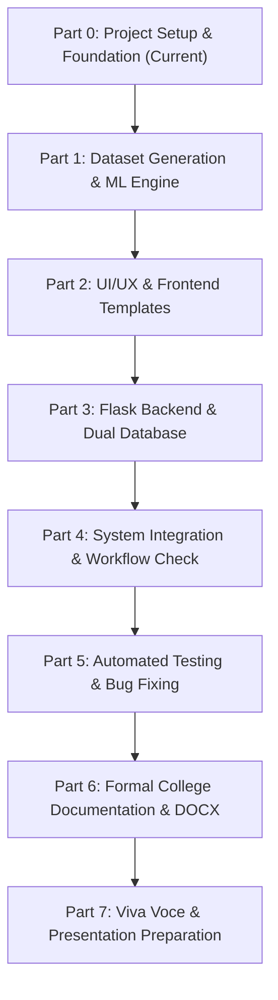

# Implementation Plan & System Architecture

## Project: AI-Powered Food Waste Prediction System
**College Project:** 3rd Semester IDT  
**Target Community:** College Mess Operators and College Students  

---

## 1. System Objectives
1. **Demand Estimation:** Predict expected student meal consumption using machine learning (Random Forest Regressor) based on attendance, day of the week, meal type, and menu category.
2. **Food Waste Tracking:** Enable mess operators to log actual meals prepared vs. consumed and compute precise food waste metrics ($Waste = Prepared - Consumed$).
3. **Actionable Analytics:** Provide daily, weekly, and menu-wise visual analytics using Chart.js to identify wasteful menus and trends.
4. **Ethical Surplus Redistribution:** Provide a human-in-the-loop surplus food advisory module that alerts operators when excess food is available, requiring physical food safety verification before contacting local NGOs.
5. **Beginner Accessibility:** Complete separation of concerns with clean, readable Python code, zero-config SQLite development mode, and optional production MySQL connectivity.

---

## 2. Technical Stack & Library Selection

### A. Backend: Flask (v3.1+) & Python (v3.14+)
- **Why Flask?** Unlike Django, Flask has minimal boilerplate, is fast to launch, and provides clear routing that beginners can immediately comprehend.
- **Why SQLAlchemy?** Provides an Object Relational Mapper (ORM) that works identically on SQLite and MySQL. This ensures students can switch databases with a single `.env` setting without changing a single line of application code.
- **Why PyMySQL?** Pure Python MySQL driver. Does not require Microsoft C++ Build Tools or compilation during installation, preventing common Windows installation errors.

### B. Machine Learning: Scikit-Learn (Random Forest Regressor)
- **Why Random Forest Regressor?**
  - Handles non-linear interactions between menu popularity, day-of-week trends (e.g. students skipping mess on weekends), and campus attendance.
  - Robust against outliers and overfitting compared to single decision trees or simple linear regression.
  - Does not suffer from convergence issues common in neural networks on tabular datasets of 500–2,000 records.
- **Target Variable ($y$):** `consumed_meals` (integer count of meals eaten).
- **Features ($X$):**
  - `expected_attendance` (integer)
  - `day_of_week` (categorical: Monday..Sunday)
  - `meal_type` (categorical: Breakfast, Lunch, Snacks, Dinner)
  - `menu_category` (categorical: Rice Meal, Roti Meal, Special Feast, Light Snacks)
  - `is_weekend` (binary flag: 0 or 1)
- **Evaluation Metrics:**
  - Mean Absolute Error (MAE): Average meal prediction deviation.
  - Coefficient of Determination ($R^2$ Score): Proportion of variance explained.

### C. Frontend: Modern Responsive SaaS Layout
- Clean green-and-white theme representing sustainability and environmental stewardship.
- Fully responsive sidebar navigation for desktop and mobile devices.
- Chart.js for canvas-based dynamic line, bar, and doughnut charts.
- Zero paid frontend frameworks; uses standard vanilla JavaScript, semantic HTML5, and clean CSS.

---

## 3. Data Flow Architecture

```
1. PRE-MEAL (Morning/Planning Phase):
   Mess Staff ──> Inputs (Date, Expected Attendance, Menu, Meal Type)
                       │
                       ▼
                 Flask Route (/api/predict)
                       │
                       ▼
                 ML Inference Pipeline (Random Forest Regressor)
                       │
                       ▼
   Predicted Consumed Meals + Recommended Preparation Range
                       │
                       ▼
   Database Log (prediction_logs table)

2. POST-MEAL (Evening/Closing Phase):
   Mess Staff ──> Inputs (Actual Meals Prepared, Actual Meals Consumed)
                       │
                       ▼
                 Flask Route (/api/records/add)
                       │
                       ▼
   Calculations:
     - Wasted Meals = Prepared - Consumed
     - Waste % = (Wasted / Prepared) * 100
     - Prediction Error = |Actual Consumed - Predicted|
                       │
                       ▼
   Database Storage (mess_records table)
                       │
                       ▼
   Dashboard & Analytics Charts Update (Chart.js)
```

---

## 4. Phase-by-Phase Execution Roadmap



---

## 5. Security, Ethics, and Constraints Checklist
- [x] **No Hardware/IoT Dependencies:** Purely software-based decision support system.
- [x] **No Paid External APIs:** All ML models run locally using Scikit-learn.
- [x] **Clear Data Transparency:** Synthetic datasets are explicitly documented as synthetic samples.
- [x] **Responsible Food Recovery:** System issues an advisory to human operators; does not execute false automated physical delivery.
- [x] **Environment Secrets Protection:** Database credentials stored exclusively in `.env` (excluded via `.gitignore`).
